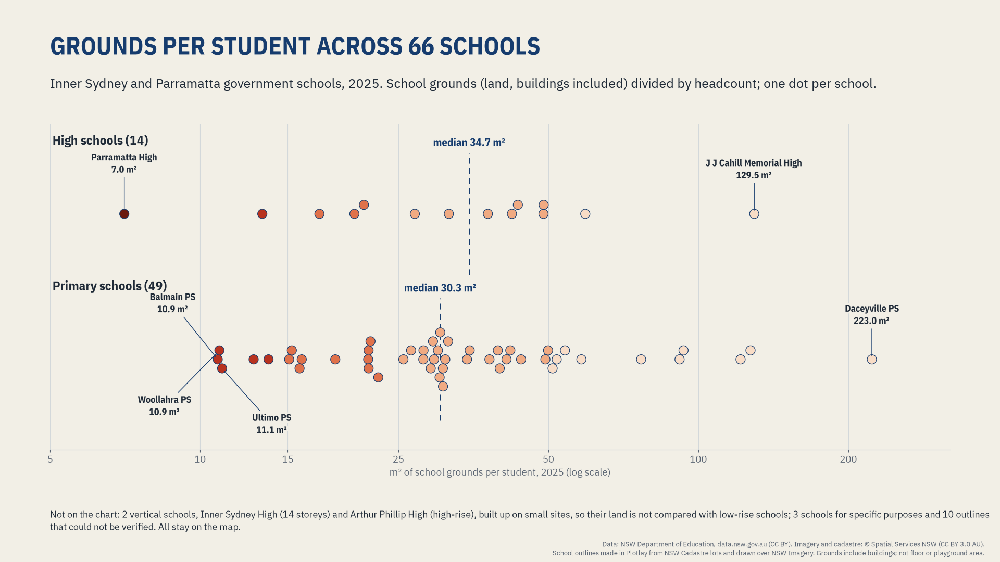
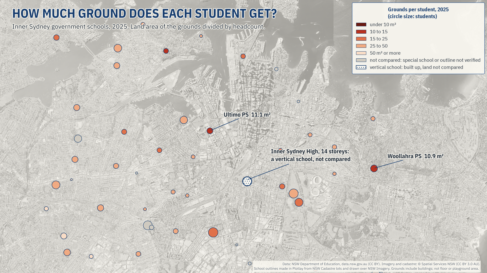

# How much ground does each student get?

NSW government schools in inner Sydney and Parramatta, measured by the land they sit on. **Live version, with an interactive map:** [getplotlay.com/showcase/sydney-schools](https://www.getplotlay.com/showcase/sydney-schools/)

**The question: how much land does each student get, across 66 inner Sydney and Parramatta government schools?**



In 2025 the median primary school had **30.3 m² of grounds per student** (49 schools) and the median high school **34.7 m²** (14 schools): a little over two car spaces of land each. The spread is wide. Half the compared schools sit between 21.8 and 47.7 m² per student; the range runs from 7.0 to 223.0 m². 7 of the 66 compared schools have under 15 m² per student, and 13 have 50 m² or more.

The tightest on land: **Parramatta High, 7.0 m² per student** (1,128 students on a small site, and not a vertical school), then the primary schools Balmain Public 10.9 m², Woollahra Public 10.9 m², Ultimo Public 11.1 m², and Mosman High 13.3 m². The roomiest: Daceyville Public 223.0 m² and J J Cahill Memorial High 129.5 m².

**Vertical schools are the exception.** Inner Sydney High (a 14-storey tower in Surry Hills, opened 2020) and Arthur Phillip High in Parramatta (rebuilt as a high-rise school for 2,000, opened 2020) put their classrooms on many floors of a small site. Their land per student says how they were built, not how much room their students have, so comparing it with low-rise schools is not fair. Both stay on the map, marked, and are left out of the medians and rankings. Inner Sydney High has its own showcase, which measures it by estimated floor space instead: [getplotlay.com/showcase/inner-sydney-high](https://www.getplotlay.com/showcase/inner-sydney-high/).

The department publishes a code, a name, a location and 22 years of headcounts for every school. It does not publish the grounds. Without a shape there is no area, and without an area there is no "per square metre". The shapes in this repository were made in [Plotlay](https://www.getplotlay.com) for that reason.

[](https://app.plotlay.io/?example=sydney-schools&as=client)

## What the data says

| Compared schools, 2025 | Grounds per student |
|---|---|
| Median, 49 primary schools | 30.3 m² (2.3 car spaces) |
| Median, 14 high schools | 34.7 m² (2.7 car spaces) |
| Middle half of all 66 | 21.8 to 47.7 m² |
| Tightest: Parramatta High (small site) | 7.0 m² (1,128 students) |
| Under 15 m² per student | 7 of 66 schools |
| 50 m² or more | 13 of 66 schools |

- **Human scale.** A standard car space (2.4 × 5.4 m, AS/NZS 2890.1) is 12.96 m². The median primary student has 2.3 of them, the median high school student 2.7.
- **The same outlines, ten years apart.** For the 64 compared schools open in both 2015 and 2025, total grounds over total students went from 32.2 to 33.2 m² per student: 25 schools got tighter and 38 roomier. The land did not change; the students did.
- **New schools open a year group at a time.** A new school's headcount climbs by design: Inner Sydney High took Year 7 only in 2020 and added a year group each year to Years 7 to 12 in 2025 (147, 358, 591, 797, 999 and 1,161 students from 2020 to 2025, for a school built for up to 1,200). The others opened since 2015 started the same way: Cammeraygal High with Year 7 in 2015 (Years 7 to 12 by 2020), Anzac Park Public (2016) and Bayanami Public (2019) with Kindergarten only in their first year, and Green Square Public with Kindergarten to Year 2 in 2025 (to Year 6 by 2027). In 2025, 3,556 students were at these five schools (2,893 of them in inner Sydney): where students are now, not a measure of demand.
- **Primary down, high school up.** Since 2019 primary enrolments in the study area fell 15.4% (24,389 to 20,641) and high school enrolments rose 13.0% (17,035 to 19,242, with Randwick Boys and Girls counted before their 2025 merger). 1,431 of the 2,207 extra high school students are Inner Sydney High and Cammeraygal High adding year groups; without those two the rise is 4.7%.
- **Attendance.** Mean semester 1 attendance was 93.7% in 2019, 88.0% in 2022 and 90.3% in 2024 (all NSW government schools: 91.0%, 84.5%, 87.0%). 68 of 72 schools were below their 2019 rate in 2024. Grounds per student and attendance show a weak link at most (Spearman −0.33, 64 compared schools); no cause is claimed.
- **Not a measure of advantage.** The department's ICSEA (Index of Community Socio-Educational Advantage, where 1000 is the national average) for the three tightest compared schools: Parramatta High 1,132, Balmain Public 1,172, Woollahra Public 1,193. Across 66 compared schools the link between grounds per student and ICSEA is weak (Spearman −0.39): more advantaged schools tend to have a little less ground per student, as many of them are inner-city schools. No cause is claimed. ICSEA is NSW Department of Education data from the same master dataset (CC BY).



### Read it carefully

- **Grounds, not floor space or playground.** The area is the land a school sits on, buildings included. A school with more storeys has more floor space on the same land, which is why the vertical schools are not compared.
- **Parks next door are not counted.** Some schools use nearby parks or sports grounds.
- **Approximate areas.** Accuracy depends on the cadastre and the imagery the outlines came from. Say "about" when you round.
- **Headcount, not capacity.** The open data has no capacity figures, so nothing here says a school is over capacity.
- **Suppressed values stay blank.** Headcounts of 5 or fewer are published as `SP`; none of these 81 schools is affected.
- **Comparisons use 66 schools.** 65 outlines were checked against the aerial imagery and are fine, 6 were adjusted, and 10 could not be verified (shared sites, or a school inside a larger campus). The ones that could not be verified, the 3 schools for specific purposes and the 2 vertical schools stay on the map but are left out of medians and rankings (`compare` and `vertical` in [`data/schools/schools.csv`](data/schools/schools.csv); see also [`data/schools/outline_checklist.csv`](data/schools/outline_checklist.csv)).
- **Headcount, 2025.** Students are the department's census headcount (not full-time equivalent), for 2025.

## How it was made with Plotlay

1. **A map project** on the NSW aerial imagery basemap, and a **Data layer** called Schools ([Data layers](https://www.getplotlay.com/features)).
2. **Pick the lots.** With **Land lots**, a click on the map asks NSW Spatial Services for the cadastre lot there. The lots clicked one after another join into one shape, so a school over 61 lots is still one outline. 75 schools were made this way.
3. **Draw the rest.** 6 schools have no lot of their own (a new school in a mixed precinct, a college inside a TAFE campus) or share a lot with another school (Sydney Boys High and Sydney Girls High on one Moore Park lot). They were drawn over the aerial imagery.
4. **Key each shape** by the department's school code (8913, 8504...).
5. **Link the tables**: one row per school, and enrolments and attendance by year. The match report showed every code matched.
6. **Colour by m² per student** (the shape's area divided by the value) and step the **time slider** from 2004 to 2025.
7. **Export** GeoJSON, TopoJSON for the Power BI Shape Map, CSV with WKT for Azure Maps, the joined data and a Python starter. Nothing in this repository comes from OpenStreetMap.

## What's here

| Folder | What |
|---|---|
| [`data/geometry/`](data/geometry) | The 81 outlines from Plotlay: GeoJSON, TopoJSON, CSV with WKT. Key: school code |
| [`data/schools/`](data/schools) | `schools.csv` (one row per school, with grounds and how the outline was made), enrolments and attendance by year, the outline checklist |
| [`python/`](python) | A narrated notebook that recomputes every number here: [`school_grounds_per_student.ipynb`](python/school_grounds_per_student.ipynb) |
| [`powerbi/`](powerbi) | A Power BI Project (`.pbip`). Start with [`powerbi/OPEN-ME.md`](powerbi/OPEN-ME.md) |
| [`visuals/`](visuals) | The charts and animations |

### Run the notebook

```
python3 -m venv .venv
.venv/bin/pip install -r python/requirements.txt
cd python && ../.venv/bin/jupyter lab school_grounds_per_student.ipynb
```

### Open the Power BI report

Open `powerbi/SydneySchoolGrounds.pbip` in Power BI Desktop and select Refresh. [`powerbi/OPEN-ME.md`](powerbi/OPEN-ME.md) has the steps, including the two map settings Power BI asks for by hand.

## The other schools showcases

- [NSW and SA schools side by side](https://www.getplotlay.com/showcase/schools-nsw-sa/): the same grounds method within 7 km of the Sydney and Adelaide town halls, on 2024 students, plus spending, staffing and outcomes for each state. Its study area and year differ from this one, so its medians do too.
- [Inner Sydney High, a deep dive](https://www.getplotlay.com/showcase/inner-sydney-high/): the vertical school left out of the comparison here, measured by its estimated floor space per student instead of its land.
- [One school campus, building by building](https://www.getplotlay.com/showcase/school-campus/): University High in Parkville drawn as its buildings and rolled up to the site, with estimated floor space.

## Sources and licences

- **Code** (notebook, Power BI project, scripts): MIT, see [`LICENSE`](LICENSE).
- **Our data** (the outlines, the joined tables, the checklist): CC BY 4.0, see [`LICENSE-DATA`](LICENSE-DATA). Credit "Plotlay (getplotlay.com)" and the sources below.
- School enrolment, attendance and school location data: NSW Department of Education (Centre for Education Statistics and Evaluation), data.nsw.gov.au, licensed under Creative Commons Attribution (CC BY) as stated on each dataset page. Changes: reshaped to one row per school per year, suppressed values left blank, contact columns removed.
- Cadastre and aerial imagery: © State of New South Wales (Spatial Services, a business unit of the Department of Customer Service NSW), licensed under CC BY 3.0 AU (https://creativecommons.org/licenses/by/3.0/au/). School outlines built from NSW Cadastre lots or traced over NSW Imagery in Plotlay.
- Vertical school facts: School Infrastructure NSW, [Inner Sydney High School project update, February 2020](https://www.schoolinfrastructure.nsw.gov.au/content/dam/infrastructure/projects/i/inner-sydney-high-school/ISHS_project_update_Feb_2020.pdf) and [Arthur Phillip High School project page](https://www.schoolinfrastructure.nsw.gov.au/projects/a/arthur-phillip-high-school).
- Staged openings: Inner Sydney High School annual reports [2021](https://reports.sparo.schools.nsw.gov.au/annual-report/2021/8913/2021_Inner_Sydney_High_School_Annual_Report.pdf) and [2025](https://reports.sparo.schools.nsw.gov.au/annual-report/2025/8913/2025_Inner_Sydney_High_School_Annual_Report.pdf); Cammeraygal High School [annual report 2020](https://reports.sparo.schools.nsw.gov.au/annual-report/2020/8910/2020_Cammeraygal_High_School_Annual_Report.pdf) and NSW Department of Education, [Cammeraygal High celebrates a decade](https://education.nsw.gov.au/news/latest-news/cammeraygal-high-celebrates-a-decade-of-empowerment) (2024); Anzac Park Public School annual reports [2016](https://reports.sparo.schools.nsw.gov.au/annual-report/2016/4656/2016_Anzac_Park_Public_School_Annual_Report.pdf) and [2017](https://reports.sparo.schools.nsw.gov.au/annual-report/2017/4656/2017_Anzac_Park_Public_School_Annual_Report.pdf); Bayanami Public School [annual report 2019](https://reports.sparo.schools.nsw.gov.au/annual-report/2019/4660/2019_Bayanami_Public_School_Annual_Report.pdf); School Infrastructure NSW, [Green Square Public School welcome pack, October 2025](https://www.schoolinfrastructure.nsw.gov.au/content/dam/infrastructure/projects/g/Green-Square-Public-School/2025/october/Green_Square_PS_-_Welcome_pack_-_October_2025_DIGITAL_2.pdf).

This is independent work using open data. It is not endorsed by the NSW Department of Education or Spatial Services. Full credits are in [`NOTICE`](NOTICE).
